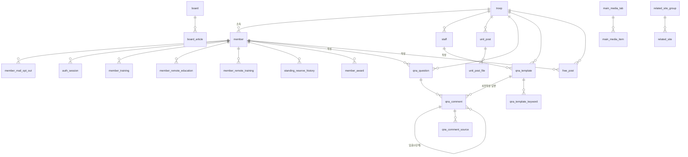

# DB 명세

[API_SPEC.md](API_SPEC.md)의 응답을 만들어 내는 데 필요한 테이블을 정리한 문서입니다. mock(`src/api/mock/db.json`)은 응답 모양의 중첩 JSON이므로, 이를 관계형 구조로 풀어 썼습니다.

- **범위:** 인덱스, 공용 레이아웃, 로그인, `/my` 페이지에서 쓰는 데이터.
- **제외:** 범위 밖 페이지에서만 쓰는 테이블과 컬럼(훈련장, 휴일훈련 계획, 훈련/연기/보류 신청, 공개 게시판 본문, 주소 검색 등).
- **표기:**
  - 타입은 일반적인 SQL 타입으로 적었습니다.
  - `API` 열은 대응하는 응답 필드입니다.
  - **백엔드 전용** 컬럼은 화면에 나가지 않지만 운영이나 권한 판단에 필요해서 추가한 것입니다.
  - 모든 테이블에 생성일시와 수정일시 같은 감사(audit) 컬럼을 두는 것을 전제로, 표에서는 생략했습니다(화면에 쓰이는 경우만 적음).

## 1. 관계도

## 2. 공통 코드

### `code`

| 컬럼 | 타입 | 제약 | 설명 | API |
| --- | --- | --- | --- | --- |
| group_key | VARCHAR(30) | PK | `banks`, `familyRelations`, `emailDomains`, `mailOptOuts` | `:group` |
| code | VARCHAR(30) | PK | 코드값 | `code` |
| name | VARCHAR(100) | NOT NULL | 표시명 | `name` |
| sort_order | INT | NOT NULL | 정렬 순서 | (배열 순서) |
| use_yn | CHAR(1) | DEFAULT 'Y' | **백엔드 전용**. 사용 여부 | |

## 3. 인덱스와 공용 레이아웃

### `main_slide`: 인덱스 히어로 슬라이드

| 컬럼 | 타입 | 제약 | 설명 | API |
| --- | --- | --- | --- | --- |
| id | VARCHAR(50) | PK | 슬라이드 키 | `id` |
| sort_order | INT | NOT NULL | | (배열 순서) |
| eyebrow | VARCHAR(100) | | 상단 작은 문구 | `eyebrow` |
| title | VARCHAR(200) | NOT NULL | `\n` 줄바꿈 포함 | `title` |
| description | VARCHAR(500) | | | `description` |
| link_label | VARCHAR(100) | | 버튼 문구. NULL이면 `link`를 내리지 않음 | `link.label` |
| link_path | VARCHAR(300) | | 내부 경로 | `link.path` |
| link_href | VARCHAR(500) | | 외부 URL (`link_path`와 배타) | `link.href` |
| theme | VARCHAR(20) | NOT NULL | `navy`, `blue`, `sky` | `theme` |
| art | VARCHAR(20) | | 기본 일러스트 키 | `art` |
| image_url | VARCHAR(500) | | | `image` |
| use_yn | CHAR(1) | DEFAULT 'Y' | **백엔드 전용** | |

### `main_banner`: 인덱스 바로가기 카드

| 컬럼 | 타입 | 제약 | 설명 | API |
| --- | --- | --- | --- | --- |
| id | VARCHAR(50) | PK | | `id` |
| sort_order | INT | NOT NULL | | |
| title | VARCHAR(100) | NOT NULL | | `title` |
| description | VARCHAR(300) | | | `description` |
| icon | VARCHAR(30) | NOT NULL | 아이콘 키 | `icon` |
| path | VARCHAR(300) | | 내부 경로 | `path` |
| href | VARCHAR(500) | | 외부 URL (`path`와 배타) | `href` |
| use_yn | CHAR(1) | DEFAULT 'Y' | **백엔드 전용** | |

### `main_faq`: 인덱스 "자주 묻는 질문" 탭

| 컬럼 | 타입 | 제약 | 설명 | API |
| --- | --- | --- | --- | --- |
| faq_id | INT | PK | FAQ 페이지 문항 번호 (`/inform/faq?faq=:id`) | `faq[].id` |
| question | VARCHAR(200) | NOT NULL | | `faq[].question` |
| sort_order | INT | NOT NULL | | |

> FAQ 페이지 본문은 현재 프론트에 하드코딩되어 있습니다(범위 밖). FAQ를 DB로 옮기면 이 테이블은 `faq` 테이블을 참조하는 노출 목록이 됩니다.

### `main_media_tab`, `main_media_item`: 인덱스 "예비군 소식"

`main_media_tab`

| 컬럼 | 타입 | 제약 | 설명 | API |
| --- | --- | --- | --- | --- |
| tab_key | VARCHAR(30) | PK | `cardnews`, `video1`, … (`video`로 시작하면 영상) | `key` |
| label | VARCHAR(50) | NOT NULL | | `label` |
| sort_order | INT | NOT NULL | | |

`main_media_item`

| 컬럼 | 타입 | 제약 | 설명 | API |
| --- | --- | --- | --- | --- |
| id | BIGINT | PK | **백엔드 전용** | |
| tab_key | VARCHAR(30) | FK → main_media_tab | | |
| sort_order | INT | NOT NULL | | |
| title | VARCHAR(200) | NOT NULL | | `items[].title` |
| image_url | VARCHAR(500) | NOT NULL | 썸네일 | `items[].image` |
| board_key | VARCHAR(30) | FK → board | 링크 대상 게시판 | `items[].board` |
| ntt_id | BIGINT | FK → board_article | 링크 대상 게시글 | `items[].nttId` |

### `board`, `board_article`: 공개 게시판 (인덱스에서 쓰는 부분만)

인덱스는 공지사항(`notice`) 상위 5건만 사용합니다. 공개 게시판의 나머지 컬럼(본문, 첨부, 이미지, 영상 URL 등)은 범위 밖입니다.

`board`

| 컬럼 | 타입 | 제약 | 설명 |
| --- | --- | --- | --- |
| board_key | VARCHAR(30) | PK | `notice`, `cardnews`, `video` |
| bbs_id | VARCHAR(30) | UNIQUE | 레거시 게시판 ID |
| name | VARCHAR(100) | NOT NULL | |

`board_article`

| 컬럼 | 타입 | 제약 | 설명 | API |
| --- | --- | --- | --- | --- |
| ntt_id | BIGINT | PK | | `nttId` |
| board_key | VARCHAR(30) | FK → board | | |
| title | VARCHAR(300) | NOT NULL | | `title` |
| important | BOOLEAN | DEFAULT false | 중요 공지 (상단 고정) | `important` |
| created_at | DATE | NOT NULL | | `createdAt` |

- **인덱스:** `(board_key, important DESC, created_at DESC)`

### `popup_notice`: 헤더 알림

| 컬럼 | 타입 | 제약 | 설명 | API |
| --- | --- | --- | --- | --- |
| id | VARCHAR(30) | PK | | `id` |
| title | VARCHAR(200) | NOT NULL | | `title` |
| content | TEXT | NOT NULL | HTML (sanitize한 뒤 저장) | `content` |
| posted_at | DATE | NOT NULL | 게시일. 정렬 기준(최신순) | `postedAt` |
| display_start | TIMESTAMP | | **백엔드 전용**. 노출 시작 | |
| display_end | TIMESTAMP | | **백엔드 전용**. 노출 종료 | |

> 레거시 레이어 팝업의 위치·크기(`top/left/width/height`)와 "오늘 하루 보지 않기" 컬럼은 새 화면에서 쓰지 않으므로 뺐습니다.

### `site_info`, `related_site_group`, `related_site`, `sns_link`: 푸터

`site_info` (한 행)

| 컬럼 | 타입 | API |
| --- | --- | --- |
| id | INT PK (항상 1) | |
| owner | VARCHAR(100) | `owner` |
| postcode | VARCHAR(10) | `postcode` |
| address | VARCHAR(300) | `address` |
| phone | VARCHAR(20) | `phone` |

`related_site_group`: `id` PK, `name`(→ `group`), `sort_order`

`related_site`: `id` PK, `group_id` FK, `label`, `href`, `sort_order`

`sns_link`: `sns_key` PK(`youtube`, `blog`, `instagram`, `facebook`, `x` → `key`), `label`, `href`, `sort_order`

## 4. 회원과 인증

### `troop`: 예비군 부대 (범위 안에서 쓰는 컬럼만)

| 컬럼 | 타입 | 제약 | 설명 | API |
| --- | --- | --- | --- | --- |
| troop_id | VARCHAR(10) | PK | 부대 코드 (`8000A14306`) | `unit.troopId` |
| name | VARCHAR(100) | NOT NULL | `개포1동대` | `unit.name` |
| phone | VARCHAR(20) | | 부대 대표번호 | `unit.phone` |

> 부대 찾기 페이지가 쓰는 주소, 시도·시군구 등은 범위 밖입니다.

### `member`: 예비군 (로그인 사용자)

| 컬럼 | 타입 | 제약 | 설명 | API |
| --- | --- | --- | --- | --- |
| member_id | BIGINT | PK | **백엔드 전용** | |
| ci | VARCHAR(100) | UNIQUE | **백엔드 전용**. 본인확인 연계정보(CI). 로그인 시 회원을 찾는 키 | |
| name | VARCHAR(50) | NOT NULL | | `name` |
| service_no | VARCHAR(20) | UNIQUE | 군번 | `serviceNo` |
| rank | VARCHAR(20) | | 계급 | `rank` |
| branch | VARCHAR(20) | | 군별 | `branch` |
| years_of_service | INT | | 예비군 연차 | `yearsOfService` |
| mobilization | VARCHAR(20) | | 동원구분 | `mobilization` |
| troop_id | VARCHAR(10) | FK → troop | 소속 부대 | `unit.*` |
| platoon | VARCHAR(50) | | 소대/분대 | `unit.platoon` |
| cell_phone | VARCHAR(20) | | 하이픈 포함 | `cellPhone` |
| home_phone | VARCHAR(20) | | | `homePhone` |
| company_phone | VARCHAR(20) | | | `companyPhone` |
| email | VARCHAR(200) | | | `email` |
| family_master | VARCHAR(50) | | 세대주 | `familyMaster` |
| family_master_relation | VARCHAR(30) | code(`familyRelations`) | | `familyMasterRelation` |
| bank_code | VARCHAR(30) | code(`banks`) | | `bank` |
| account | VARCHAR(30) | | 계좌번호. **암호화 저장 권장** | `account` |
| notice_way | CHAR(1) | `Y`/`N` | Y 이메일, N 이메일 + 우편 | `noticeWay` |
| birthday_sms_opt_out | BOOLEAN | DEFAULT false | | `birthdaySmsOptOut` |
| outing_area | VARCHAR(100) | | 출타 지역 | `outingArea` |
| outing_start | DATE | | | `outingStart` (`""` ↔ NULL) |
| outing_end | DATE | CHECK ≥ outing_start | | `outingEnd` |
| outing_purpose | VARCHAR(200) | | | `outingPurpose` |
| outing_phone | VARCHAR(20) | | | `outingPhone` |
| proxy_name | VARCHAR(50) | | 대리 수령인 | `proxyName` |
| proxy_phone | VARCHAR(20) | | | `proxyPhone` |

> 범위 밖 페이지가 쓰는 `birth_date`, `service_type`, `address`, `position`, `discharge_year`는 이 문서에 넣지 않았습니다.

### `member_mail_opt_out`: 이메일 수신 거부 항목

| 컬럼 | 타입 | 제약 | API |
| --- | --- | --- | --- |
| member_id | BIGINT | PK, FK → member | |
| code | VARCHAR(30) | PK, code(`mailOptOuts`) | `mailOptOut[]` |

### `auth_session`: 로그인 세션

| 컬럼 | 타입 | 제약 | 설명 | API |
| --- | --- | --- | --- | --- |
| session_id | VARCHAR(64) | PK | 쿠키 값(해시로 저장 권장) | |
| member_id | BIGINT | FK → member | | |
| auth_method | VARCHAR(10) | NOT NULL | `simple`, `phone`, `ipin` | 로그인 `method` |
| logged_in_at | TIMESTAMP | NOT NULL | | |
| expires_at | TIMESTAMP | NOT NULL | 로그인이나 연장 시 현재 + 15분 | `expiresAt` (epoch ms) |
| logged_out_at | TIMESTAMP | | 로그아웃 시각 | |

> Redis 같은 세션 저장소를 쓴다면 이 테이블 대신 같은 키 구성으로 저장하면 됩니다.

## 5. 훈련 정보

### `member_training`: 예비군 훈련 (일반 + 상비예비군)

| 컬럼 | 타입 | 제약 | 설명 | API |
| --- | --- | --- | --- | --- |
| training_id | VARCHAR(30) | PK | | `id` |
| member_id | BIGINT | FK → member | | |
| program | VARCHAR(10) | NOT NULL | `regular`(`/me/training`) \| `standing`(`/me/standing-reserve`) | 응답 구분 |
| training_year | INT | NOT NULL | 올해면 `trainings`, 이전이면 `pastTrainings` | |
| type_code | VARCHAR(10) | NOT NULL | 훈련 유형 코드 | `typeCode` |
| type_name | VARCHAR(50) | NOT NULL | `기본훈련`, `작계훈련(후반기)` 등 | `typeName` |
| round | VARCHAR(20) | | `1차` | `round` |
| start_date | DATE | NOT NULL | | `date` (`YYYY.MM.DD`) |
| end_date | DATE | NOT NULL | 하루 훈련이면 start와 같음 | `date` (`…~YYYY.MM.DD`) |
| planned_hours | INT | DEFAULT 0 | 계획시간 | `plannedHours` |
| done_hours | INT | DEFAULT 0 | 실시시간 | `doneHours` |
| remaining_hours | INT | DEFAULT 0 | 잔여시간 | `remainingHours` |
| result | VARCHAR(20) | | `참석`, `통지취소` 등 | `result` |
| result_type | VARCHAR(10) | | `attend`, `defer` | `resultType` |
| schedule_state | SMALLINT | 1~3 | 1 종료, 2 변경 가능, 3 변경 불가 | `scheduleState` |
| center | VARCHAR(200) | | 훈련장 이름 또는 주소 | `center` |
| certificate_available | BOOLEAN | DEFAULT false | 교육필증 발급 가능 | `certificate` |
| notice_available | BOOLEAN | DEFAULT false | 소집통지서 발급 가능 | `notice` |

- **인덱스:** `(member_id, program, training_year, start_date)`
- 교육필증과 소집통지서 HTML은 이 행과 `member`, `troop`으로 만들어 냅니다. 별도 테이블이 필요 없습니다.
- `schedule_state`, `remaining_hours`를 다른 컬럼에서 계산할 수 있다면 저장하지 않고 조회할 때 계산해도 됩니다.

### `member_remote_education`: 연도별 원격교육 선정

| 컬럼 | 타입 | 제약 | API |
| --- | --- | --- | --- |
| member_id | BIGINT | PK, FK | |
| edu_year | INT | PK | `year` |
| status | VARCHAR(20) | NOT NULL | `remoteEducation.status` (`대상`, `비대상`) |
| reason | VARCHAR(200) | | `remoteEducation.reason` (제외사유) |

### `member_remote_training`: 원격교육 훈련내용

| 컬럼 | 타입 | API |
| --- | --- | --- |
| id | BIGINT PK | `id` |
| member_id | BIGINT FK | |
| edu_year | INT | `year` |
| name | VARCHAR(200) | `name` |
| period_start, period_end | DATE | `period` (화면용 문자열로 조합) |
| result | VARCHAR(20) | `result` |
| hours | INT | `hours` |
| note | VARCHAR(200) | `note` |

### `standing_reserve_history`: 상비예비군 편성 이력

| 컬럼 | 타입 | API |
| --- | --- | --- |
| id | BIGINT PK | `id` |
| member_id | BIGINT FK | |
| period_start, period_end | DATE | `period` |
| troop_name | VARCHAR(100) | `troop` (소집부대) |
| type | VARCHAR(50) | `type` (구분) |
| release_reason | VARCHAR(200) | `releaseReason` |

### `member_award`: 예비군 상훈

| 컬럼 | 타입 | API |
| --- | --- | --- |
| id | BIGINT PK | `id` |
| member_id | BIGINT FK | |
| award_date | DATE | `date` |
| order_basis | VARCHAR(200) | `order` (명령근거) |
| note | VARCHAR(200) | `note` |

## 6. 소속부대 게시판

### `staff`: 부대 담당자 (작성자 표시용)

| 컬럼 | 타입 | 제약 | 설명 |
| --- | --- | --- | --- |
| staff_id | BIGINT | PK | |
| troop_id | VARCHAR(10) | FK → troop | |
| display_name | VARCHAR(50) | NOT NULL | `개포1동대장`. 댓글 `author`로 노출 |

> 담당자용 관리 화면은 이 프론트에 없습니다. 담당자 계정과 권한 모델은 관리 시스템 쪽에서 정합니다.

### `unit_post`, `unit_post_file`: 소속부대 공지사항, 훈련안내

`unit_post`

| 컬럼 | 타입 | 제약 | 설명 | API |
| --- | --- | --- | --- | --- |
| post_id | VARCHAR(30) | PK | | `id` |
| troop_id | VARCHAR(10) | FK → troop | 조회 범위 | |
| board | VARCHAR(20) | NOT NULL | `notices` \| `training-notices` | `:board` |
| title | VARCHAR(300) | NOT NULL | | `title` |
| body | TEXT | NOT NULL | HTML (에디터 작성, sanitize) | `body` |
| views | INT | DEFAULT 0 | | `views` |
| created_at | DATE | NOT NULL | | `createdAt` |
| staff_id | BIGINT | FK → staff | **백엔드 전용**. 작성 담당자 | |

- **인덱스:** `(troop_id, board, created_at DESC)`
- 검색(`searchCnd` 1, 2)은 본문 HTML 대상이므로, 규모가 크면 태그를 뺀 텍스트 컬럼이나 전문 검색 인덱스를 고려합니다.

`unit_post_file`

| 컬럼 | 타입 | 제약 | API |
| --- | --- | --- | --- |
| post_id | VARCHAR(30) | PK, FK → unit_post | |
| file_sn | INT | PK | `attachments[].fileSn` |
| name | VARCHAR(255) | NOT NULL | `attachments[].name` |
| size | BIGINT | NOT NULL | `attachments[].size` (byte) |
| storage_path | VARCHAR(500) | NOT NULL | **백엔드 전용** |

- 목록의 `hasAttachment`는 첨부 존재 여부(EXISTS)로 계산합니다.

### `qna_question`: 나의 질의응답

| 컬럼 | 타입 | 제약 | 설명 | API |
| --- | --- | --- | --- | --- |
| question_id | VARCHAR(30) | PK | | `id` |
| troop_id | VARCHAR(10) | FK → troop | 작성 당시 소속 부대 (조회 범위) | |
| member_id | BIGINT | FK → member | 작성자 | `mine` (요청자와 비교), `writer` (이름 마스킹) |
| writer_phone | VARCHAR(20) | | 작성 시점 휴대폰 (API 7절 8번 참고) | `phone` (마스킹) |
| title | VARCHAR(100) | NOT NULL | | `title` |
| body | TEXT | NOT NULL | 일반 텍스트를 이스케이프한 뒤 `
`로 바꾼 HTML | `body` |
| email | VARCHAR(200) | | 답변 알림 주소 | `email` (상세는 마스킹, edit은 원문) |
| is_public | BOOLEAN | DEFAULT true | | `public` |
| views | INT | DEFAULT 0 | | `views` |
| status | VARCHAR(10) | NOT NULL | `pending`, `answered`, `followUp` | `status` |
| answered_at | TIMESTAMP | | 첫 답변 시각 | `answeredAt` (`MM.DD HH:mm`) |
| rating | SMALLINT | 0~5, DEFAULT 0 | 만족도 | `rating` |
| summary_body | TEXT | | LLM 요약 (일반 텍스트) | `summary.body` |
| summary_updated_at | TIMESTAMP | | NULL이면 `summary: null` | `summary.updatedAt` |
| created_at | TIMESTAMP | NOT NULL | | `createdAt` (날짜만) |
| deleted_at | TIMESTAMP | | **백엔드 전용**. 소프트 삭제 권장 | |

- **인덱스:** `(troop_id, created_at DESC)`, `(troop_id, status)`
- `canEdit`, `canComment`, 목록의 `commentCount`는 `qna_comment`에서 계산합니다. API 6.2절의 규칙을 따릅니다.

### `qna_comment`: 질의응답 댓글

| 컬럼 | 타입 | 제약 | 설명 | API |
| --- | --- | --- | --- | --- |
| comment_id | VARCHAR(40) | PK | | `id` |
| question_id | VARCHAR(30) | FK → qna_question | | |
| parent_id | VARCHAR(40) | FK → qna_comment, NULL | 최상위 댓글만 참조 가능 (답글은 한 단계까지) | `replies` 구조 |
| role | VARCHAR(10) | NOT NULL | `writer`, `staff`, `ai`, `template` | `role` |
| kind | VARCHAR(10) | | `role = ai`일 때 `answer` \| `handoff` | `kind` |
| author_member_id | BIGINT | FK → member | `role = writer` | |
| author_staff_id | BIGINT | FK → staff | `role = staff`, `template`(템플릿 작성자) | |
| author_name | VARCHAR(50) | NOT NULL | 표시 이름 (작성 시점) | `author` |
| body | TEXT | NOT NULL | 일반 텍스트, 최대 1000 byte | `body` |
| template_id | VARCHAR(20) | FK → qna_template | `role = template` | `template.*` |
| created_at | TIMESTAMP | NOT NULL | | `createdAt` |
| deleted_at | TIMESTAMP | | handoff는 담당자 댓글이 달리면 삭제 처리 | |

- **CHECK 제약:**
  - `role = ai`이면 `kind`가 NOT NULL이어야 합니다.
  - `role = template`이면 `template_id`가 NOT NULL이어야 합니다.
  - `kind = handoff`인 댓글은 자식(답글)을 가질 수 없습니다. 이 조건은 애플리케이션에서 검증합니다.
- **인덱스:** `(question_id, created_at)`
- 템플릿은 나중에 바뀔 수 있으므로, 댓글 `body`에 게시 당시 본문을 복사해 둡니다. `template.title`과 `template.updatedAt`도 당시 값을 보여주려면 `template_title`, `template_updated_at` 스냅샷 컬럼을 추가합니다.

### `qna_comment_source`: AI 답변 근거

| 컬럼 | 타입 | 제약 | API |
| --- | --- | --- | --- |
| comment_id | VARCHAR(40) | PK, FK → qna_comment | |
| seq | INT | PK | (배열 순서) |
| title | VARCHAR(200) | NOT NULL | `sources[].title` |
| url | VARCHAR(500) | | `sources[].url` (`/`로 시작하면 내부, 그 외 외부, NULL이면 링크 없음) |

### `qna_template`, `qna_template_keyword`: 부대별 사전작성 답변

`qna_template`

| 컬럼 | 타입 | 제약 | 설명 | API |
| --- | --- | --- | --- | --- |
| template_id | VARCHAR(20) | PK | | `template.id` |
| troop_id | VARCHAR(10) | FK → troop | 이 부대의 질의에만 적용 | |
| staff_id | BIGINT | FK → staff | 작성자. 게시 시 `author` | |
| title | VARCHAR(100) | NOT NULL | | `template.title` |
| body | TEXT | NOT NULL | 일반 텍스트 | 댓글 `body` |
| updated_at | DATE | NOT NULL | | `template.updatedAt` |
| use_yn | CHAR(1) | DEFAULT 'Y' | **백엔드 전용** | |

`qna_template_keyword`: `template_id` PK/FK, `keyword` PK (VARCHAR(50)).

- **매칭 조건:** 질의 제목과 본문, 또는 작성자 댓글에 키워드가 포함되어 있고, 그 질의에서 아직 쓰지 않은 템플릿이어야 합니다.
- 실제 서비스에서는 키워드 대신 임베딩 유사도 같은 다른 방식으로 바꿔도 테이블 구조는 그대로 둘 수 있습니다.

### `free_post`: 자유게시판

| 컬럼 | 타입 | 제약 | 설명 | API |
| --- | --- | --- | --- | --- |
| post_id | VARCHAR(30) | PK | | `id` |
| troop_id | VARCHAR(10) | FK → troop | 조회 범위 | |
| member_id | BIGINT | FK → member | 작성자 | `mine`, `writer` (마스킹) |
| title | VARCHAR(100) | NOT NULL | | `title` |
| body | TEXT | NOT NULL | 이스케이프한 뒤 `
`로 바꾼 HTML | `body` |
| is_public | BOOLEAN | DEFAULT true | | `public` |
| views | INT | DEFAULT 0 | | `views` |
| created_at | TIMESTAMP | NOT NULL | | `createdAt` (날짜만) |
| deleted_at | TIMESTAMP | | **백엔드 전용** | |

- **인덱스:** `(troop_id, created_at DESC)`

## 7. 파생 값 정리

저장하지 않고 조회할 때 계산하는 값입니다.

| API 필드 | 계산 |
| --- | --- |
| `writer` (Q&A, 자유게시판) | `member.name`에서 공백을 뺀 뒤 첫 글자와 끝 글자만 남기고 `*` (`J*****e`) |
| `phone` (Q&A) | `010****5678` |
| `email` (Q&A 상세) | 앞 3자 + `*****` + `@도메인` |
| `mine` | 작성자 `member_id` = 세션 `member_id` |
| `canComment` | `mine` 또는 요청자가 그 부대 담당자 |
| `canEdit` | `mine`이고, 삭제되지 않은 댓글이 모두 `writer` 또는 `ai/handoff` |
| `commentCount` | 삭제되지 않은 댓글과 답글 수. `ai/handoff`는 제외 |
| `hasAttachment` | `unit_post_file` 존재 여부 |
| `Training.date` | `start_date`와 `end_date`가 같으면 `YYYY.MM.DD`, 다르면 `YYYY.MM.DD~YYYY.MM.DD` |
| `trainings` / `pastTrainings` | `training_year`가 기준 연도와 같은지, 그보다 이전인지 |
| `AuthUser.expiresAt` | `auth_session.expires_at`을 epoch ms로 변환 |
